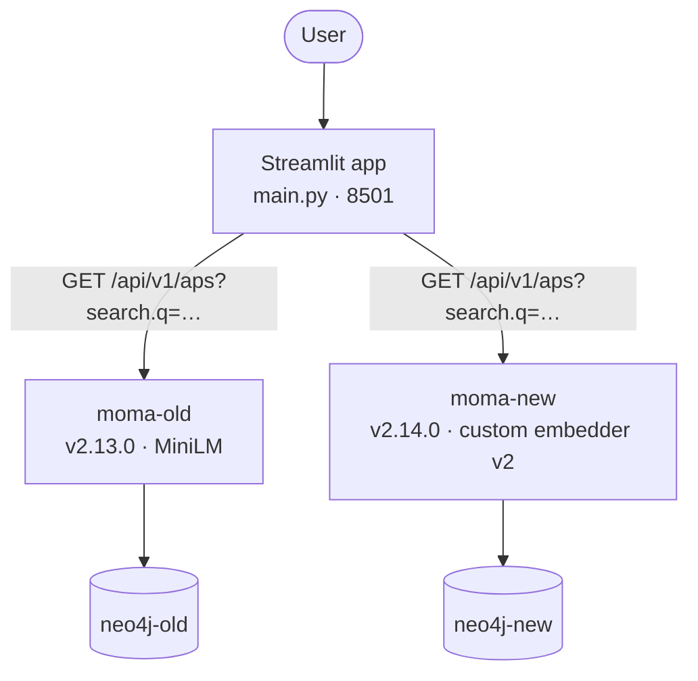

# AP search: today's and the new one

A Streamlit app that runs the same question through two real moma-management searches over the
same 605 Analytical Patterns, and shows their results side by side.

| Search | Service | Model | Text an AP is embedded from |
|---|---|---|---|
| **Today's search** | moma-management v2.13.0 | `all-MiniLM-L6-v2` | the AP's own root description |
| **New search** | moma-management v2.14.0 | [`SoTrxII/analytical-pattern-embedder:v2`](https://huggingface.co/SoTrxII/analytical-pattern-embedder), EmbeddingGemma 2 fine-tuned to match tasks to APs | the description built from its operators (`AnalyticalPattern.describe()`) |

The APs and questions are the test set of moma-management's
`packages/analytical-pattern-embedder`: 12 real APs, 593 generated ones, and 1,365 questions
none of which was trained on. Each question has an expected AP.

| Tab | What it does |
|-----|--------------|
| **🔎 Search** | Pick a test question (real, or generated for an AP seen in training, or for operators never seen) or type your own. Each search shows its top 10. The expected AP is marked in green, its building blocks (shorter APs it is made of) too, and APs that do more than asked in grey. The text each search embedded is under every result. |
| **📊 Benchmark** | Runs a set of questions through both searches and scores them as the embedder's benchmark does: recall@1, recall@10, nDCG@10. Then lists, per question, where each search ranks the expected AP. |

## The 0.75 threshold

moma-management only returns APs scoring at least `search.threshold`, **0.75 by default**, and
ap-management's searches leave the default. The *Mark what the threshold cuts* box and the
benchmark's second row per search show what that removes: with today's search most real questions
get no result at all, and with the new one most still do. The benchmark of the embedder ranks
without any threshold.

## Running it

Open the folder in its dev container, or with Docker alone:

```bash
docker compose -f docker-compose.yml -f .devcontainer/docker-compose.dev.yml up -d   # dev container stack
uv run streamlit run main.py                                                         # inside the app container
```

In VS Code, the *Python:Streamlit* launch configuration (F5) does the second line. Running
`main.py` as a plain Python file does not work: Streamlit apps are started by `streamlit run`.

`docker-compose.yml` alone builds and runs the app too, behind an external `traefik` network.

- **First start:** moma-new downloads the model (about 550 MB) into the `hf-cache` volume.
- **First page load:** the app loads the 605 APs into both searches. The new one embeds them on
  CPU, which takes a few minutes (`OMP_NUM_THREADS` is set in the compose file). The APs stay in the two Neo4j containers, so this happens
  once.

## Architecture



Each search has its own Neo4j: both use the same vector index name, sized for their model (384
and 768 dimensions).

## Refreshing the assets

`assets/` is a copy of `dataset/generated/evaluation/{aps/, aps.jsonl, tasks.jsonl}` from
`moma-management/packages/analytical-pattern-embedder`. After the dataset is regenerated, copy
them again and empty both Neo4j: `docker compose down -v`, which also drops the model cache.
